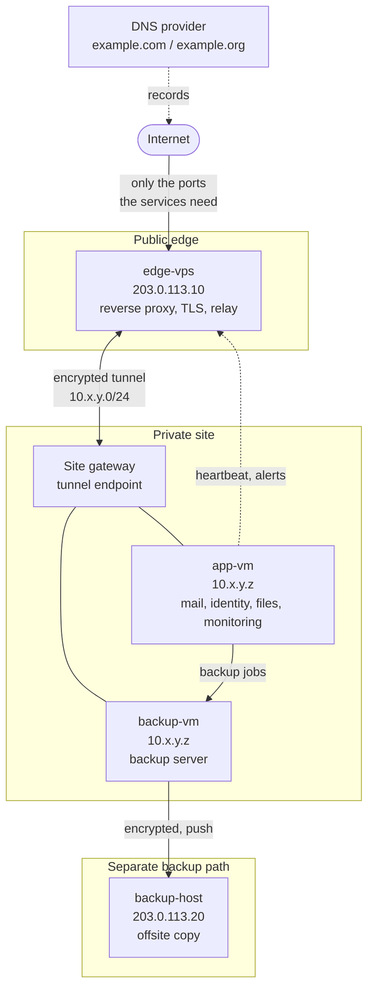

# Architecture

All names, addresses and ports are placeholders. See the conventions table in the [README](../README.md).

## Overview

## Components

| Role | Placeholder name | Purpose |
|------|------------------|---------|
| Public edge | `edge-vps` | Only host reachable from the internet. Terminates TLS and forwards traffic through the tunnel. |
| Application services | `app-vm` | Runs the application containers: mail, identity, password manager, file sync, monitoring. |
| Backup server | `backup-vm` | Receives VM and file backups from the private site. Accepts connections only from the hosts that need them. |
| Offsite copy | `backup-host` | Holds an encrypted copy of the backups in a different location. |

## Network boundaries

- **Internet to edge:** only the ports the services need. SSH accepts key authentication only.
- **Edge to private site:** one encrypted tunnel. The private site accepts no inbound connections from the internet; access arrives through the tunnel.
- **Private site:** the backup server accepts connections only from the hosts that need them, enforced by a host firewall.
- **Backups:** pushed outward from the backup server, never pulled in.

## Open sections

_Planned: certificate issuance and renewal, mail path (inbound, outbound, authentication records), monitoring and alert routing, and the backup schedule._
